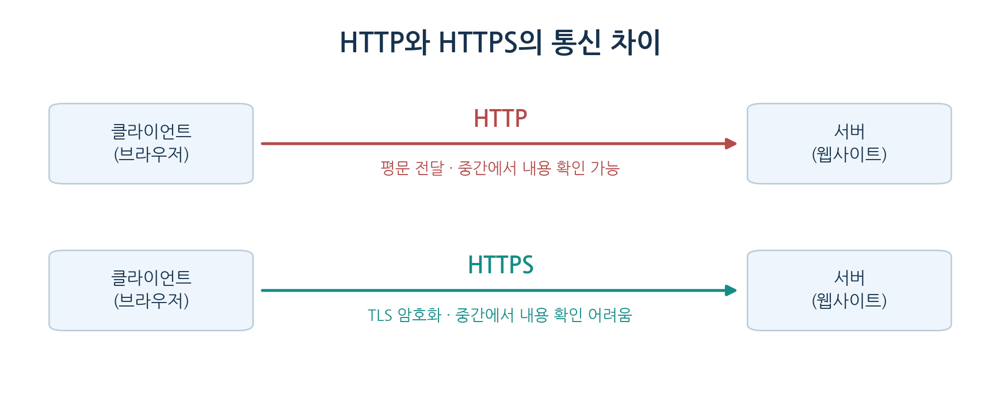
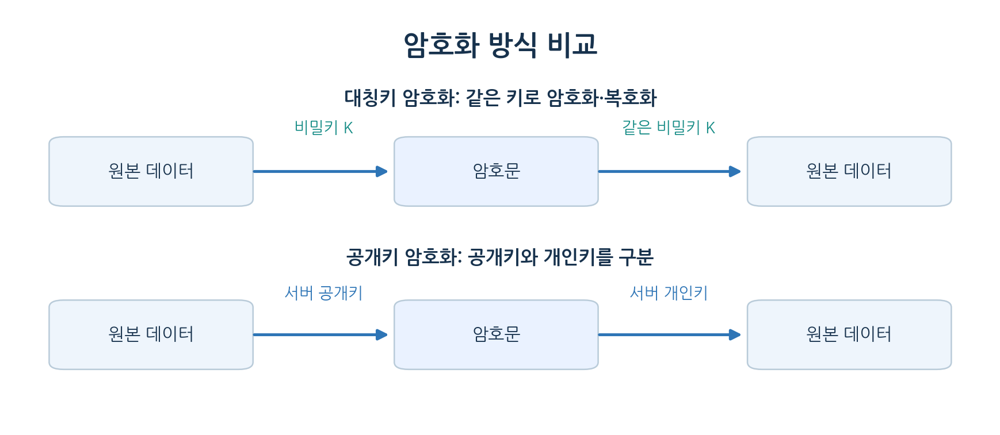
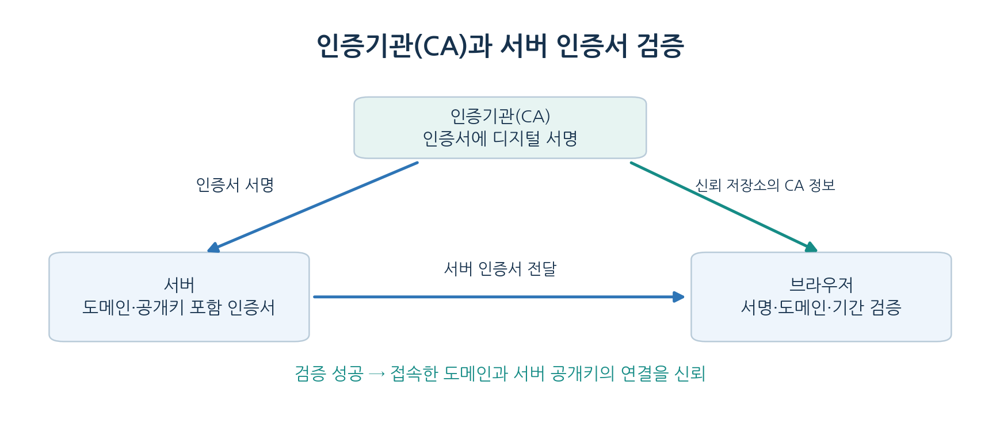
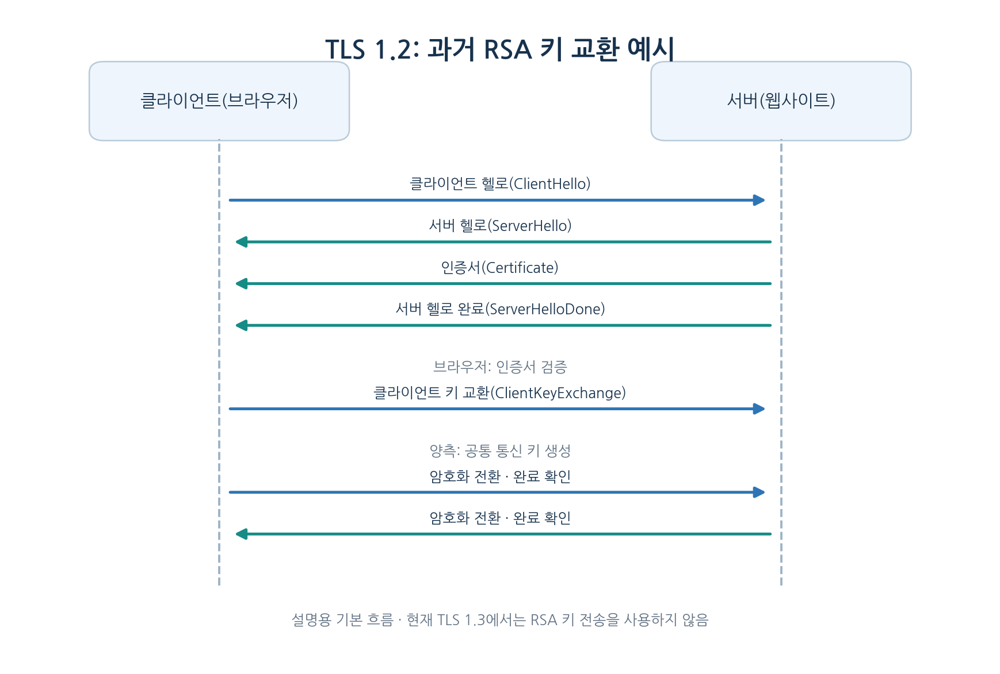
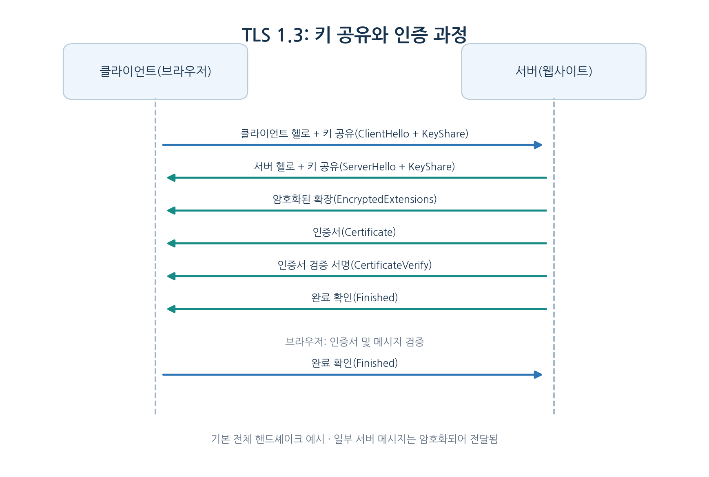
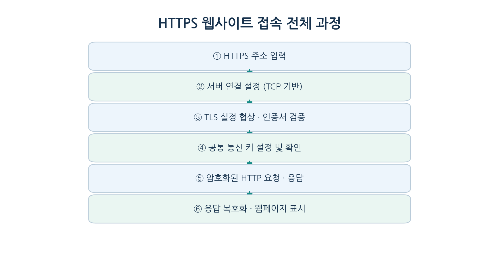

# 📑 HTTP vs HTTPS / SSL 핸드셰이크 정리

> **발표자**: 최묘석  
> **날짜**: 2026-11-12  
> **카테고리**: Network  
> **참고 링크**: [gyoogle 기술인터뷰 - Network](https://github.com/gyoogle/tech-interview-for-developer/tree/master/Computer%20Science/Network)

---

## 1. 개요 및 정의

> HTTP와 HTTPS의 차이를 알아보고, 안전한 통신을 시작하기 위한 TLS 핸드셰이크의 목적을 정리.

### HTTP와 HTTPS란?

**HTTP(하이퍼텍스트 전송 프로토콜, HyperText Transfer Protocol)**는 웹 브라우저와 서버가 요청과 응답을 주고받기 위한 통신 규칙이다. HTTP 자체는 통신 내용을 암호화하지 않으므로, 중간에서 내용을 읽거나 변경할 위험이 있다.

**HTTPS(보안 HTTP, HyperText Transfer Protocol Secure)**는 HTTP 통신을 **TLS(전송 계층 보안, Transport Layer Security)**로 보호하는 방식이다. TLS는 통신 내용을 암호화하고, 서버의 신원을 확인하며, 데이터 변조를 탐지할 수 있도록 한다.

### 먼저 알아야 할 용어

| 용어 | 의미 |
| :--- | :--- |
| 클라이언트(Client) | 웹페이지 등의 서비스를 요청하는 프로그램. 대표적으로 웹 브라우저 |
| 서버(Server) | 요청을 받아 처리하고 응답을 보내는 프로그램 또는 컴퓨터 |
| 프로토콜(Protocol) | 통신할 때 지키는 규칙 |
| 요청(Request) / 응답(Response) | 클라이언트가 보내는 요구 / 서버가 돌려주는 결과 |
| 평문(Plaintext) | 암호화되지 않아 내용을 읽을 수 있는 데이터 |
| 암호문(Ciphertext) | 암호화되어 원래 내용을 바로 읽기 어려운 데이터 |
| SSL(보안 소켓 계층, Secure Sockets Layer) | TLS 이전에 사용된 보안 통신 프로토콜. 현재는 사용하지 않는 구형 방식 |
| TLS(전송 계층 보안) | HTTPS 통신의 암호화·인증·무결성 보호를 담당하는 프로토콜 |

### HTTP의 세 가지 보안 문제

| 문제 | 설명 | HTTPS의 대응 |
| :--- | :--- | :--- |
| 도청(Eavesdropping) | 제3자가 통신 내용을 읽을 수 있음 | 암호화로 기밀성 확보 |
| 위장(Impersonation) | 공격자가 정상 서버인 것처럼 행동할 수 있음 | 인증서로 서버 신원 확인 |
| 변조(Tampering) | 전달 중 데이터가 바뀔 수 있음 | 암호학적 무결성 검증 |

---

## 2. 핵심 동작 원리 및 특징

> HTTPS에 필요한 암호화 기술과 인증서의 역할을 이해하고, TLS 핸드셰이크의 메시지 교환 과정을 살펴본다.

### 2-1. HTTP와 HTTPS 비교

| 구분 | HTTP | HTTPS |
| :--- | :--- | :--- |
| 통신 내용 | 기본적으로 평문 | TLS로 암호화 |
| 서버 신원 확인 | HTTP 자체에서는 제공하지 않음 | 서버 인증서 검증 |
| 데이터 무결성 | HTTP 자체에서는 보장하지 않음 | TLS가 변조 탐지 기능 제공 |
| 기본 포트 번호 | 80 | 443 |
| 주소 시작 | `http://` | `https://` |

HTTPS는 HTTP의 요청·응답 구조를 없애는 것이 아니라, **HTTP 메시지가 오가는 통신 구간을 TLS로 보호**하는 방식이다.

### 2-2. 대칭키 암호화와 공개키 암호화

| 용어 | 의미 |
| :--- | :--- |
| 암호화(Encryption) | 원래 데이터를 읽기 어려운 형태로 바꾸는 과정 |
| 복호화(Decryption) | 암호문을 원래 데이터로 되돌리는 과정 |
| 대칭키(Symmetric Key) | 암호화와 복호화에 공통으로 사용하는 비밀키 |
| 공개키(Public Key) | 다른 사람에게 공개할 수 있는 키 |
| 개인키(Private Key) | 키 소유자만 보관하는 비밀키 |
| 세션 키(Session Key) | 하나의 통신 세션에서 데이터 보호에 사용하는 키 |

**대칭키 암호화(Symmetric Encryption)**는 같은 비밀키를 이용해 암호화와 복호화를 수행한다. 처리 속도가 빨라 실제 웹 데이터 전송에 사용되지만, 비밀키를 안전하게 공유해야 한다.

**공개키 암호화(Asymmetric Encryption)**는 공개키와 개인키를 구분하여 사용한다. 예를 들어 공개키로 암호화한 데이터는 대응하는 개인키로 복호화할 수 있다. 다만 실제 TLS에서는 공개키 암호화뿐 아니라 **디지털 서명**과 **키 교환**도 중요하다.

HTTPS는 핸드셰이크에서 안전하게 통신 키를 설정한 뒤, 실제 HTTP 데이터를 빠른 대칭키 암호화로 보호한다.

### 2-3. 인증기관(CA)과 서버 인증서

공개키를 받았다고 해도 그것이 정말 접속하려는 서버의 공개키인지 확인할 필요가 있다.

**인증기관(CA, Certificate Authority)**은 서버의 도메인 정보와 공개키 등이 담긴 **디지털 인증서(Digital Certificate)**에 서명하여 검증을 가능하게 하는 기관이다.

| 용어 | 의미 |
| :--- | :--- |
| 인증서(Certificate) | 서버의 도메인, 공개키, 발급자, 유효기간 등을 담은 전자 문서 |
| 디지털 서명(Digital Signature) | 인증서 내용이 신뢰할 수 있는 발급자에 의해 서명되었는지 검증하는 수단 |
| 신뢰 저장소(Trust Store) | 브라우저나 운영체제가 신뢰하는 인증기관 정보를 저장한 곳 |
| 인증서 체인(Certificate Chain) | 서버 인증서에서 신뢰된 최상위 인증기관까지 이어지는 인증 관계 |

브라우저는 서버가 제시한 인증서의 **서명, 도메인 일치 여부, 유효기간, 인증 경로** 등을 확인한다. 인증서 자체를 CA의 개인키로 통째로 암호화하는 것이 아니라, **CA가 인증서에 디지털 서명**한다는 점이 중요하다.

또한 인증서가 유효하다고 해서 해당 웹사이트의 내용이나 운영자가 무조건 안전하다는 뜻은 아니다.

### 2-4. TLS 핸드셰이크란?

**핸드셰이크(Handshake)**는 클라이언트와 서버가 실제 암호화 통신에 앞서 보안 설정을 협상하고, 서버를 인증하고, 통신 키를 설정하는 과정이다.

TCP의 **3방향 연결 설정(3-Way Handshake)**과 TLS 핸드셰이크는 목적이 다르다. TCP는 연결을 수립하고, TLS는 그 연결 위에서 안전한 통신을 준비한다. 다만 HTTP/3은 TCP 대신 QUIC을 사용하므로 연결 과정이 다르다.

### 2-5. TLS 핸드셰이크 메시지 용어

| 영어 메시지 | 한국어 의미 | 역할 |
| :--- | :--- | :--- |
| ClientHello | 클라이언트 인사 메시지 | 지원 TLS 버전·암호화 방식 등 제안 |
| ServerHello | 서버 인사 메시지 | 사용할 보안 설정 선택 |
| Certificate | 인증서 메시지 | 서버 인증서 전달 |
| ClientKeyExchange | 클라이언트 키 교환 메시지 | 구형 TLS 1.2 RSA 방식에서 키 설정 자료 전달 |
| ChangeCipherSpec | 암호화 설정 전환 알림 | TLS 1.2에서 이후 메시지 보호 방식 전환을 알림 |
| Finished | 핸드셰이크 완료 확인 메시지 | 이전 핸드셰이크 교환 내용 검증 |
| 난수(Random) | 무작위로 생성한 값 | 키 생성 등에 사용 |
| 사전 마스터 비밀값(Pre-Master Secret) | 키 생성의 기초가 되는 비밀값 | 구형 TLS 1.2 RSA 키 교환에서 사용 |
| 마스터 비밀값(Master Secret) | 통신 키 도출에 쓰는 비밀값 | TLS 1.2에서 사용 |

### 2-6. TLS 1.2의 RSA 키 교환 흐름

다음은 **과거 TLS 1.2에서 사용하던 RSA 키 교환 방식**을 기준으로 한 예시이다. 모든 TLS 1.2 연결이 이 방식을 사용하는 것은 아니며, 현재 TLS 1.3에서는 RSA 키 전송을 사용하지 않는다.

진행 과정은 다음과 같다.

1. **클라이언트 헬로(ClientHello)**: 브라우저가 지원하는 TLS 버전, 암호화 알고리즘, 난수 등을 전달한다.
2. **서버 헬로(ServerHello)**: 서버가 사용할 암호화 설정을 선택하고 인증서를 보낸다.
3. **인증서 검증(Certificate Validation)**: 브라우저가 서버의 인증서를 확인한다.
4. **키 교환(Key Exchange)**: 클라이언트가 사전 마스터 비밀값을 서버 공개키로 암호화하여 전달하고, 서버는 개인키로 복호화한다.
5. **통신 키 생성(Key Derivation)**: 양측이 공유한 비밀값과 난수를 이용해 실제 통신 키를 생성한다.
6. **완료 확인(Finished)**: 양측이 핸드셰이크 내용의 무결성을 검증한 뒤 암호화 통신을 시작한다.

서버가 클라이언트 인증서를 요청하는 **상호 TLS 인증(mTLS, Mutual TLS)**도 있지만, 일반적인 웹사이트 접속에서는 주로 서버 인증만 수행한다.

### 2-7. TLS 1.3은 무엇이 다른가?

현대적인 TLS 1.3은 구형 RSA 키 전송 방식을 제거하고, 주로 **(EC)DHE(임시 디피-헬먼 키 교환)**로 공유 비밀값을 계산한다. 클라이언트와 서버는 비밀값 자체를 네트워크로 보내지 않고도 공통 키를 만들 수 있다.

TLS 1.3에서는 서버 인증서 등 일부 핸드셰이크 메시지도 키 교환 이후 암호화된다. 또한 전체 연결 설정에 필요한 왕복 횟수가 줄어든다.

이 부분은 기본적인 RSA 키 교환 설명을 넘어서는 최신 프로토콜의 차이이므로 별도로 확인했다.

**보충 참고**: [RFC 8446 - TLS 1.3](https://www.rfc-editor.org/rfc/rfc8446)

### 2-8. HTTPS 통신의 전체 흐름

HTTPS는 통신 내용의 보호에 목적이 있다. 따라서 IP 주소 등 일부 통신 정보가 보일 수 있으며, HTTPS를 사용한다는 사실만으로 사이트의 모든 위험이 사라지는 것은 아니다.

---

## 3. 실무 / 면접 핵심 포인트

> 자주 질문받는 개념을 중심으로 차이점과 동작 원리를 정리.

### Q1. HTTP와 HTTPS의 차이점을 설명하시오.

- **A**: HTTP는 웹에서 요청과 응답을 주고받는 프로토콜이며, 자체적으로 암호화를 제공하지 않습니다. HTTPS는 HTTP 통신에 TLS를 적용하여 기밀성, 무결성, 서버 인증을 지원합니다. 일반적으로 HTTP는 80번 포트, HTTPS는 443번 포트를 사용합니다.

### Q2. HTTPS에서 대칭키 암호화와 공개키 기술을 함께 사용하는 이유를 설명하시오.

- **A**: 대칭키 암호화는 처리 속도가 빨라 실제 데이터 전송에 적합하지만, 통신 키를 안전하게 설정해야 합니다. TLS 핸드셰이크에서는 공개키 기반 인증과 키 교환 기술을 이용하여 안전하게 통신 키를 설정하고, 이후 HTTP 데이터는 대칭키 방식으로 암호화합니다. TLS 1.3은 주로 (EC)DHE 키 교환을 사용합니다.

### Q3. TLS 핸드셰이크와 TCP 3-Way Handshake의 차이점을 설명하시오.

- **A**: TCP 3-Way Handshake는 데이터 전송을 위한 TCP 연결을 설정하는 과정입니다. TLS 핸드셰이크는 암호화 방식 협상, 서버 인증서 검증, 통신 키 설정 등을 통해 보안 통신을 준비하는 과정입니다. 따라서 두 핸드셰이크는 이름이 비슷하지만 목적이 다릅니다.

### 학습하며 느낀 점

처음에는 HTTPS를 단순히 HTTP를 암호화한 것이라고 이해했다. 하지만 암호화뿐 아니라 **통신 상대를 인증하고 데이터가 변경되지 않았는지 확인하는 과정**도 중요하다는 점을 알게 되었다.

특히 대칭키와 공개키의 역할을 구분하면서, 실제 데이터를 모두 공개키로 암호화하는 것이 아니라 핸드셰이크에서 안전하게 키를 설정하고 이후에는 대칭키를 사용한다는 흐름을 이해할 수 있었다.

또한 TCP의 연결 설정과 TLS 핸드셰이크를 비교하면서, 네트워크 통신에서는 연결을 만드는 과정과 그 연결을 안전하게 보호하는 과정이 서로 다른 역할을 담당한다는 점을 정리했다.

---

## 4. 오프라인 모임 Q&A 기록 (발표 후 작성)

> 스터디원들과 나눈 질문이나 토론 내용을 발표 후 작성.

- **Q (스터디원 A)**:
- **A (발표자)**:
- **느낀 점 / 보충할 점**:
